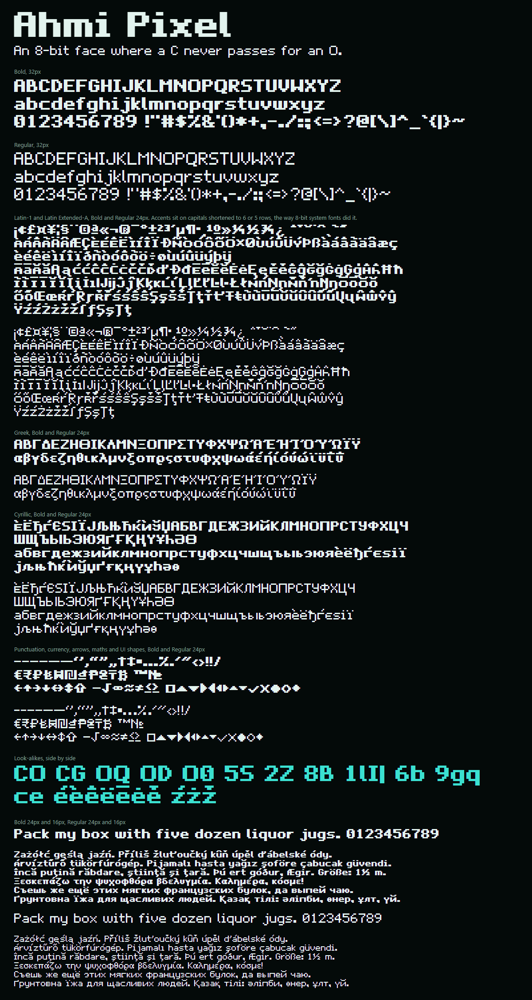

# Ahmi Pixel

An 8-bit style typeface in two weights, drawn for [Ahmi Darrow's site](https://r20ohhka.rf.gd/).
It was made because the pixel font the site used before had a capital C that read as an O and a 5 that read as an S. In Ahmi Pixel every look-alike pair is checked by a script before the fonts are built.

Version 1.100 (on this branch). The last public release is [v1.0.0](https://github.com/AhmiDarrow/AhmiPixelFont/releases/tag/v1.0.0).



## What's here

| Path | What it is |
|---|---|
| `fonts/` | Ready-to-use files: `AhmiPixel-Regular` and `AhmiPixel-Bold`, each as `.ttf` and `.woff2` |
| `glyphs/` | The source. Every character drawn as a grid of `#` and `.`: `ahmi-pixel.txt` (Basic Latin, and the format), `latin.txt`, `marks.txt` (accents), `greek.txt`, `cyrillic.txt`, `symbols.txt` |
| `build.py` | Turns the glyph files into the font files, composing accented letters from a base letter and a mark |
| `check.py` | Fails if a required character is missing or any two characters could be mistaken for each other |
| `specimen.html` | Open in a browser to see every character |
| `LICENSE` | SIL Open Font License 1.1 |
| `CHANGELOG.md` | Release history |

## Using it on a web page

```css
@font-face {
  font-family: "Ahmi Pixel";
  src: url("fonts/AhmiPixel-Regular.woff2") format("woff2");
  font-weight: 400;
}
@font-face {
  font-family: "Ahmi Pixel";
  src: url("fonts/AhmiPixel-Bold.woff2") format("woff2");
  font-weight: 700;
}
h1 { font: 700 64px/1.1 "Ahmi Pixel", sans-serif; }
```

One font pixel is 1/8 of the font size (capitals are 7 pixels, the 8th row above them holds accents, and descenders hang 2 below). Line spacing is the same as in 1.000 (7 pixels up, 2 down, `USE_TYPO_METRICS` set), so accents above capitals can reach into the line above when lines are set tight; the Windows clipping box covers them. The letters are only pixel-sharp at sizes that are multiples of 8px: 16, 24, 32, 40, 48, 64 and so on. Other sizes work but look slightly soft.

## The two weights

- **Regular** is exactly the pixels in the glyph file: 1-pixel strokes, capitals 7 pixels tall, lowercase 5.
- **Bold** thickens every pixel one step to the right, giving 2-pixel stems and 1-pixel bars, the look of arcade and console lettering. Where that would close up a counter, the glyph file carries a hand-drawn bold version (currently only the zero).

## Characters

583 characters in each weight, everything FreeSpeak needs with no fallback font:

- Basic Latin, Latin-1 Supplement and Latin Extended-A in full, plus ƒ and Romanian Ș ș Ț ț, and the spacing accents ˆ ˇ ˘ ˙ ˚ ˛ ˜ ˝
- modern (monotonic) Greek
- Cyrillic U+0400–045F (Russian, Ukrainian, Belarusian, Bulgarian, Serbian, Macedonian) and Ґ Ғ Қ Ң Ү Ұ Һ Ә Ө with their lowercase
- general punctuation (dashes, quotes, daggers, ‰, primes, ‹ › ‼ ⁄) and the thin, hair, narrow no-break, figure and punctuation spaces
- currency € ₹ ₽ ₺ ₩ ₪ ₫ ₱ ₴ ₸ ₿, ™ №, arrows ← ↑ → ↓ ↔ ↕ ⇧, maths − √ ∞ ≈ ≠ ≤ ≥
- the shapes the egui toolkit draws itself: ◻ ▲ ▼ ► ◄ ⏴ ⏵ ⏶ ⏷ ✓ ✗ ● ○, and ◆

The font is proportional, not monospaced.

**Accents.** Each accent is drawn once, in `glyphs/marks.txt`, and `build.py` places it (`@ U+00E9 eacute = e + m.acute`). Over lowercase letters an accent fits above the x-height with an empty row between, like the dot of the i. Capitals already fill 7 of the 8 rows, so an accented capital is shortened to 6 rows (one-row accents: dot, diaeresis) or 5 rows (two-row accents), the way 8-bit system fonts did it; `build.py` drops a repeated row of the stem, or uses a hand-drawn short form such as `@part G.5`. The accent shapes were picked so that any two that occur on the same letter (é è ê ë ē ĕ ė ę ě, and so on) differ by at least 3 pixels in both weights.

**Greek and Cyrillic** letters shaped like Latin ones (А В Е К М Н О Р С Т Х, Α Β Ε Ζ Η Ι Κ Μ Ν Ο Ρ Τ Υ Χ, а е о р с у х, ο ν κ ...) reuse the Latin drawing. `check.py` lists these intended look-alikes in `HOMOGLYPHS`; no other pair is exempt.

## Changing a letter

1. Edit its grid in `glyphs/`. The comments at the top of `glyphs/ahmi-pixel.txt` explain the layout and the composition rules.
2. Run the checks, then rebuild:

```bash
pip install fonttools brotli
python check.py
python build.py
```

`check.py` enforces these rules in both weights:

- every required character is drawn and the built files contain it; every character except the spaces has pixels, and the spaces have the right widths;
- every letter and digit has the right number of closed counters (a C with a closed counter is an O), and none gains or loses one in Bold;
- C and c keep an opening at least 3 pixels tall;
- every pair of letters and digits, in all three scripts (about 98,000 pairs), plus look-alike symbol pairs, differ by at least 3 pixels and a tenth of their ink, or stand at clearly different heights. Only the same letter in upper and lower case and the intended cross-script look-alikes are exempt.

## License

Ahmi Pixel is licensed under the [SIL Open Font License, Version 1.1](LICENSE). You can use it freely in personal and commercial projects, embed it in apps and websites, and modify or redistribute it under the same license. The font itself may not be sold on its own.
